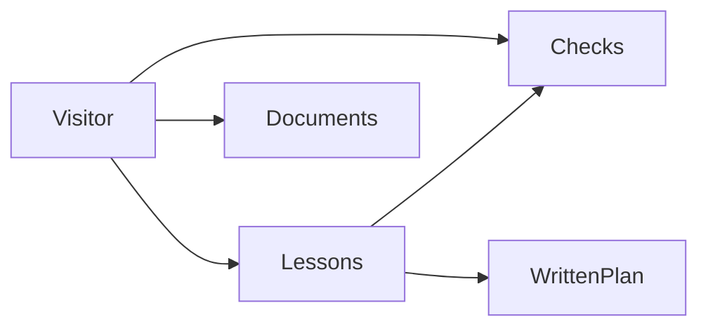
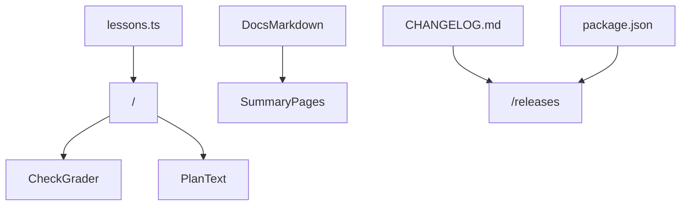
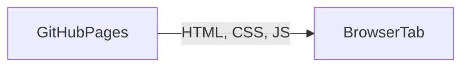

# Architecture and design

**Product:** Groma

**Last updated:** 2026-10-17

## Summary

Groma is a static Next.js site. The short path lives in `content/lessons.ts` and renders on `/`. The browser compares a chosen answer with the lesson's answer and shows the explanation. The plan button reveals text that was written with the lesson. It does not run Terraform.

`/language` is a reading page: origins, HCL, comparisons, the license change, and where Terraform is used. `/vision` and `/architecture` read the Summary section of the two documents at build time. `/releases` renders `CHANGELOG.md`. The header chip reads the version from `package.json`.

Hosting is a free static export on GitHub Pages at [jmaret.github.io/Groma](https://jmaret.github.io/Groma/). The Pages build sets `BASE_PATH=/Groma` so styles and the survey grid load under that path. A local build leaves the path empty. There is no database and no paid API. The pictures on the architecture page are the conceptual, logical, and physical views. The Mermaid diagrams later in this document are the same three views, and they change together.

## Conceptual

The visitor meets lessons, checks, and the living documents. A lesson can show its written plan. The plan is part of the lesson. Checks are too.

Lessons are one page. `/` holds nine configurations, ordered from a root module through a data source. Checks are questions about those configurations. Documents are the vision, the architecture, and the release notes. `/language` is a reading page beside them, written in the page itself rather than in those files. The written plan is shown only after the visitor asks for it, and it stays on the page.

## Logical

Lesson text, the documents, and the version are separate inputs. The lesson page is the one that grades a check or reveals a plan.

- `content/lessons.ts` holds the chapter, the explanation, the configuration, the notice, the checks, and the plan text. The answer id stays with the check. The page compares the chosen option with that id. The last lesson also carries a cloud resource block that is rendered apart from the plan.
- `src/app/page.tsx` renders the short path. The lesson view grades the check and reveals the plan.
- `src/app/language/page.tsx` is the reading page on origins, comparisons, and use. It does not grade a check and it does not show a plan.
- `src/lib/docs.ts` reads a file at build time and returns the body of `## Summary`. The vision and architecture pages render that body. They do not keep a second copy.
- `package.json` version is the header chip. `CHANGELOG.md` is the releases page.
- The three pictures on `/architecture` are SVG in `src/components/architecture/Diagrams.tsx`. They match these Mermaid diagrams.

## Physical

The host stores files. The browser grades checks and shows the plan. No Terraform binary and no cloud account are involved.

- The static host is GitHub Pages. The public address is `https://jmaret.github.io/Groma/`. The workflow sets `BASE_PATH=/Groma` so styles, scripts, and the grid load from that prefix. A local build leaves `BASE_PATH` empty. The export contains the pages, the fonts, the survey grid, and the icon. It does not contain Terraform.
- The browser downloads those files and grades checks in the tab. The plan text is already in the page. Answers are not sent anywhere and are not stored.
- There is no third host. A real `terraform plan` would need a local Terraform and, for a cloud resource, credentials. This site does not start that process.

## Visual system

The chrome matches AetherForge.

- Tokens in `src/app/globals.css`: ink `#152028`, muted `#5A6B76`, accent `#0F4C5C` / hover `#0C3D4A`, line `#D8C4AA`, paper `#F6EAD8`.
- Type: Source Serif 4, Source Sans 3, IBM Plex Mono, shipped as files under `src/app/fonts/` so a production build does not download them.
- Body: fixed `hero-bg.svg`, a survey grid on petrol. A light-brown wash (`#F6EAD8`) is stronger over the content column and lighter at the edges.
- Chrome: sticky header and footer use that light brown with a blur. Surfaces use `.panel`. Buttons are `.btn-accent` and `.btn-ghost`.
- The mark is a groma, a cross on a staff with two plumb bobs, on a warm tan circle (`#E6CA98`), in the header and in `public/icon.svg`.
- The product name in the header is Groma, with no subtitle.

## Decisions

| Decision | Choice | Why |
| --- | --- | --- |
| Site | Next.js static export on GitHub Pages | Zero cost. The Pages workflow ships `out/` to `https://jmaret.github.io/Groma/` |
| Checks | Graded in the browser | No account and no round trip |
| Plan | Written text in the lesson | Terraform has no official in-browser runner, and apply needs credentials this site must not hold |
| Examples | `random` and `local` providers | A visitor can run them later with no cloud account |
| Cloud shape | An S3 block that is not planned | The shape is visible, and copying the planned configuration does not target AWS |
| Docs in the app | Summary section only | The page stays short. The file stays complete |
| Pictures | SVG on the page, Mermaid in this document | Both describe the same three views |
| Name | Groma | The product name is that word alone |
| Visual system | AetherForge tokens and type | One family with the other rooms |
| Backdrop | Survey grid | The lines laid out before anything is built |

## Changelog

- 2026-10-17 — Plan text repeats the arguments in the configuration. Computed values stay marked known after apply.
- 2026-10-17 — First room: static export, nine lessons, in-browser checks, written plans, three architecture views, and summary pages. GitHub Pages serves `https://jmaret.github.io/Groma/`.
